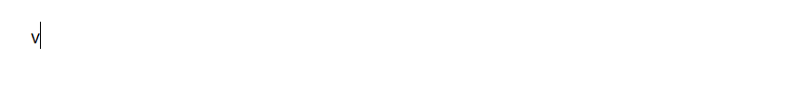
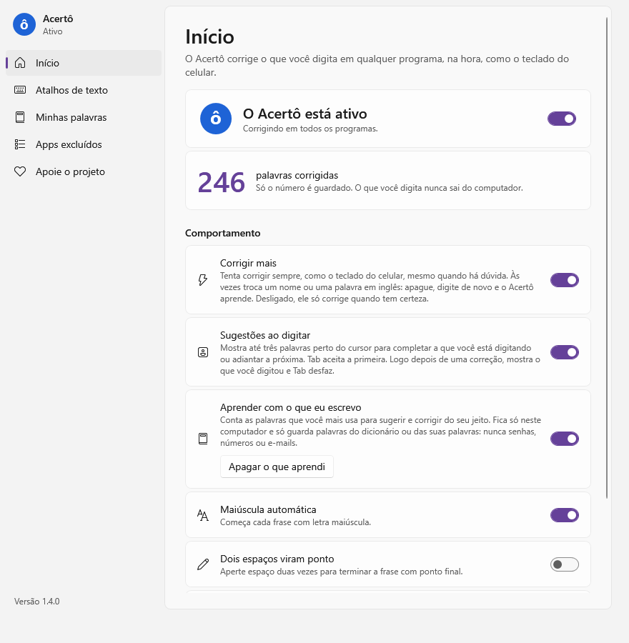
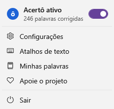
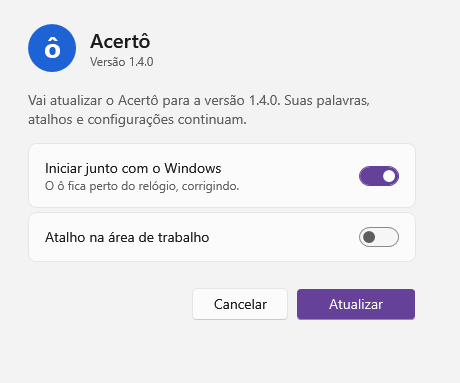
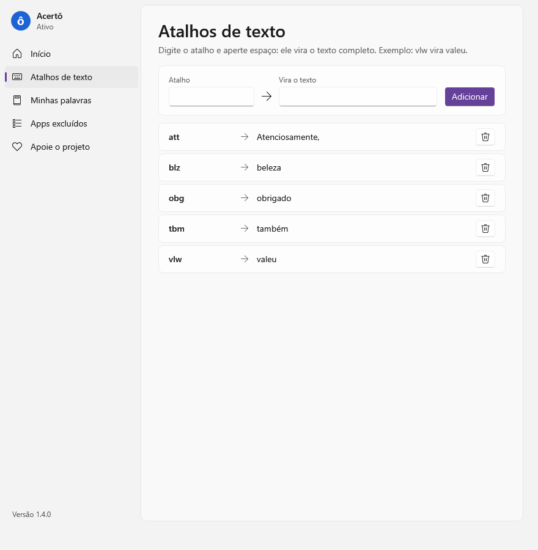

<div align="center">


# Acertô

**Corretor automático para Windows, em português, que funciona em qualquer programa — igual ao teclado do celular.**

[](https://github.com/RichardCarraro/Acerto/releases/latest)

[](https://github.com/RichardCarraro/Acerto/releases/latest)
[](https://github.com/RichardCarraro/Acerto/releases)




</div>

Você digita `nao`, aperta espaço e ele já virou `não`. Sem sublinhado vermelho, sem clicar em nada. Funciona no navegador, no Word, no Teams, no WhatsApp Desktop, no app do Claude, no Bloco de Notas — em qualquer lugar onde se digita.

## O que ele faz

- **Corrige sozinho ao terminar a palavra** (espaço, Enter ou pontuação):
  - acento e cedilha esquecidos — `informacao` → `informação`, `voce` → `você`, e também em formas que existem sem acento mas quase ninguém usa: `chegara` → `chegará`, `veiculo` → `veículo`
  - erros de digitação — `mutio` → `muito`, `paara` → `para`, `probelma` → `problema`, `hje` → `hoje`
  - erros comuns de escrita — `concerteza` → `com certeza`, `excessao` → `exceção`, `idéia` → `ideia`
  - trocas de som — `enxente` → `enchente`, `xinelo` → `chinelo`, `paralização` → `paralisação`
- **Usa o contexto**, como o celular: `minha cas` → `casa`, `esse cas` → `caso`, `ele esta` → `ele está`. Olha também a palavra seguinte: em `isso e muito`, quando o `muito` termina, o `e` vira `é`. Locuções vêm de uma lista feita à mão: `isso ai` → `isso aí`, `fica a vontade` → `à vontade`, `as vezes` → `às vezes`, `a viajem` → `a viagem`.
- **Sugestões ao digitar**: uma barrinha perto do cursor mostra até três palavras para completar a atual (mesmo com erro: `obrgi` → `obrigado`) ou adiantar a próxima. **Tab** aceita a primeira. Logo depois de uma correção, **Tab** desfaz.
- **Aprende o seu jeito**: as palavras e sequências que você mais usa passam na frente. Apagou a correção e digitou de novo? Ele mantém e não corrige mais.
- **Maiúscula automática** no começo da frase e em nomes: `fui para curitiba` → `Curitiba`, `joao` → `João`, `maringa` → `Maringá`.
- **Atalhos de texto** personalizáveis: `vlw` → `valeu`, `att` → `Atenciosamente,`.
- **Dois espaços viram ponto final**, e uma **animação** rápida mostra o que mudou.
- **Não mexe** em campos de senha, em programas rodando como administrador, em jogos em tela cheia, nem em editores de código e terminais (configurável).

## Telas

<table>
<tr>
<td width="62%" valign="top">
<picture>
  <source media="(prefers-color-scheme: dark)" srcset="docs/img/main-home-escuro.png">
  
</picture>
</td>
<td valign="top">
<picture>
  <source media="(prefers-color-scheme: dark)" srcset="docs/img/flyout-escuro.png">
  
</picture>
<p><sub>Clique no <b>ô</b> perto do relógio para pausar, abrir as configurações ou sair.</sub></p>
<picture>
  <source media="(prefers-color-scheme: dark)" srcset="docs/img/instalador-escuro.png">
  
</picture>
<p><sub>Instalação em um clique, sem administrador. Atualizar mantém suas palavras e atalhos.</sub></p>
</td>
</tr>
</table>

## Instalação

1. Baixe o **`Acerto-Setup-<versão>.exe`** na [página de versões](https://github.com/RichardCarraro/Acerto/releases/latest).
2. Abra e clique em **Instalar**. Não precisa de administrador.
3. Pronto: o ícone **ô** aparece perto do relógio. **Ctrl+Shift+F12** pausa e retoma de qualquer lugar.

> [!NOTE]
> O instalador não tem assinatura digital, então o Windows pode mostrar "O Windows protegeu o computador". Clique em **Mais informações → Executar assim mesmo**.

Para atualizar, basta rodar o instalador novo. Para desinstalar, use **Configurações > Apps**.

## Privacidade

Tudo roda no seu computador. O Acertô **não se conecta à internet** e **não grava o seu texto**. Em `%APPDATA%\Acerto` ficam só o número de palavras corrigidas, as palavras que você ensinou, os seus atalhos e, com "Aprender com o que eu escrevo" ligado, a contagem das palavras do dicionário que você usa (`historico.txt`). Senhas, números e e-mails nunca entram nessa contagem; dá para desligar ou apagar tudo nas configurações.

## Configurações

| Opção | O que faz |
|---|---|
| Corrigir mais | Tenta corrigir sempre, como o celular, mesmo com dúvida. Desligado, só corrige quando tem certeza. |
| Sugestões ao digitar | Mostra a barrinha de sugestões; Tab aceita a primeira (logo depois de uma correção, Tab desfaz). |
| Aprender com o que eu escrevo | Conta as palavras que você usa para sugerir e corrigir do seu jeito. Botão "Apagar o que aprendi". |
| Maiúscula automática | Começa as frases com maiúscula. |
| Dois espaços viram ponto | Espaço duplo termina a frase. |
| Destacar a palavra corrigida | Liga ou desliga a animação. |
| Iniciar com o Windows | Abre sozinho ao ligar o computador. |

Também dá para editar **atalhos de texto**, **minhas palavras** (que nunca são corrigidas) e **apps excluídos**.

<p align="center">
<picture>
  <source media="(prefers-color-scheme: dark)" srcset="docs/img/main-shortcuts-escuro.png">
  
</picture>
</p>

## Números

Medido com `tests/Acerto.Eval` (erros gerados nas palavras mais usadas e frases reais fora dos dados de treino):

| | |
|---|---|
| Erros de digitação corrigidos (modo "Corrigir mais") | **~94%** |
| Acerto em frases reais, com contexto | **93,0%** (89,7% sem contexto) |
| Acento esquecido que volta | **83,0%** |
| Frases do dia a dia com erros reais que saem certas | **94,1%** (529 frases; nenhuma frase certa é mexida) |
| Erros de escrita por som corrigidos | **87%** |
| Palavras certas estragadas em texto real | **0,12%** |
| Letras economizadas pelo Tab (palavras de 4+ letras) | **~29%** |

## Limitações conhecidas

- No modo "Corrigir mais", palavras em inglês digitadas em minúsculo às vezes são trocadas (`list` → `lista`). Apague e digite de novo que ele aprende, ou desligue o modo.
- Não funciona em programas abertos como administrador (limitação do Windows), a não ser que o Acertô também seja aberto como administrador.
- A barra de sugestões e a animação só aparecem em programas que informam a posição do cursor. Em apps que informam só o cursor (como o Evernote), a animação é posicionada por estimativa e pode ficar um pouco deslocada.
- Na pesquisa do Windows a correção funciona, mas a barra de sugestões e a animação ficam atrás dela: o Windows só deixa desenhar por cima da pesquisa programas assinados e instalados em Arquivos de Programas.
- Na barra de endereço do Chrome, Edge e Firefox a correção usa o perfil cuidadoso (para não trocar nomes de site). Outros campos com autocompletar que seleciona texto (Excel) podem confundir a correção; adicione-os em "Apps excluídos" se acontecer.
- A troca de acento pela palavra seguinte não acontece quando a seguinte termina com `.` ou `:` (eles esperam para ver se é e-mail ou site).

## Como funciona

<details>
<summary>O corretor, a parte do Windows e a estrutura do projeto</summary>

O corretor (`Acerto.Core`) é uma biblioteca .NET independente do Windows:

1. **Dicionário** pt-BR completo (VERO/Hunspell, o do LibreOffice) para saber se a palavra existe.
2. **Lista de frequência** de palavras para saber quais são mais usadas.
3. **Modelo de erro de digitação** com pesos: letras invertidas, letra dobrada, letra faltando e tecla vizinha no teclado ABNT2 custam menos que erros improváveis.
4. **Pares de palavras vizinhas** (bigramas) para usar a palavra anterior como contexto e para sugerir a próxima.
5. **Lista curada** de quase mil erros comuns, minerados do corpus e revisados à mão.

A parte do Windows (`Acerto.Windows`) escuta o teclado com um hook global, troca a palavra enviando as teclas de volta ao programa e usa UI Automation para saber onde está o cursor (para a animação, as sugestões e para corrigir já a primeira palavra de um campo). A interface é WPF com o tema do Windows 11.

```
src/Acerto.Core          corretor, contexto, sugestões, motor de texto (sem dependência de Windows)
src/Acerto.Windows       app de bandeja: hooks, injeção de teclas, interface, instalador
tests/Acerto.Core.Tests  testes (incluem as 60 mil palavras mais usadas que não podem ser alteradas)
tests/Acerto.Eval        medição de acerto, mineração de erros comuns, bigramas
tests/Acerto.SmokePad    teste ponta a ponta que digita numa janela
tests/Acerto.Bancada     digita frases com erros sorteados e compara o app com o motor
tests/Acerto.UiShots     gera as imagens das telas
data/                    dicionário, frequências, correções, locuções, nomes, bigramas
installer/               gerar.ps1: publica e gera o instalador
```

</details>

## Desenvolvimento

<details>
<summary>Compilar, testar e publicar uma versão</summary>

Requer só o **.NET 10 SDK**.

```bash
# testes (≈ 6 min)
dotnet test tests/Acerto.Core.Tests

# programa (publish/) e instalador (dist/Acerto-Setup-<versão>.exe)
powershell -ExecutionPolicy Bypass -File installer/gerar.ps1
```

O instalador é o próprio `Acerto.exe` publicado como arquivo único, com os dados embutidos: aberto fora da pasta de instalação, mostra a janela de instalação; instalado, roda normal. Instala em `%LOCALAPPDATA%\Programs\Acerto` sem pedir administrador, cria o atalho no Iniciar e aparece em Configurações > Apps. Ver `src/Acerto.Windows/Setup.cs`.

**Publicar uma versão:** mude `<Version>` em `src/Acerto.Windows/Acerto.Windows.csproj`, faça o commit e suba uma tag com o mesmo número:

```bash
git tag v1.4.1
git push origin v1.4.1
```

O GitHub Actions (`.github/workflows/release.yml`) compila o instalador e publica a versão em [Releases](https://github.com/RichardCarraro/Acerto/releases) sozinho.

**Ferramentas:**

- `AcertoBancada.exe frases=20 alvo=chrome saida=bancada.txt` (também `alvo=caixa|edge|firefox`, `rico=1`, `semente=N`, `rapido=1`), com o Acertô aberto, digita como uma pessoa e diz se o app ficou diferente do motor e quanto corrigiu certo. Navegadores abrem num processo separado com perfil temporário. Não mexa no mouse e no teclado enquanto ele roda.
- `texto="frase" quadros=pasta` grava a correção quadro a quadro (é assim que o GIF acima foi feito).
- `ACERTO_DIAG=<arquivo>` antes de abrir o Acertô grava só estados (foco, motivo de cada reset, posição do realce), nunca o texto.
- Para melhorar o corretor em ciclos medidos, veja [docs/melhoria-continua.md](docs/melhoria-continua.md).

</details>

## Créditos

O Acertô usa o trabalho destes projetos:

- Dicionário **VERO**, do LibreOffice
- Lista de frequência **FrequencyWords**, de Hermit Dave
- Biblioteca **WeCantSpell.Hunspell**
- Pares de palavras da **Leipzig Corpora Collection**

Licenças completas em [THIRD-PARTY-NOTICES.md](THIRD-PARTY-NOTICES.md).

## Apoie

O Acertô é grátis. Se ele te ajuda, considere apoiar o projeto pela página **Apoie o projeto** dentro do app. ⭐ Uma estrela aqui no GitHub também ajuda outras pessoas a encontrarem.
